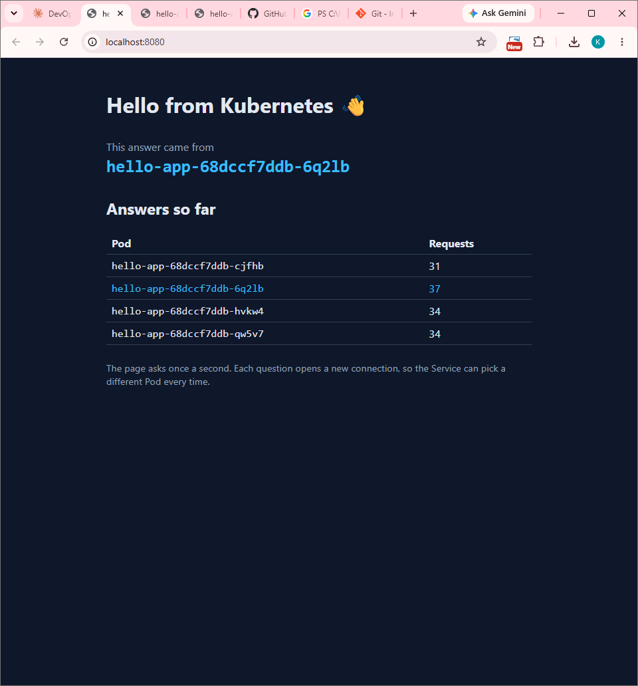

# Lab 2 — hello-app on Kubernetes

Your copy of this repository is your submission. The lab sheet is on the course site; this file is where you record what you did.

What's here:

| File | What it is |
|---|---|
| `src/`, `index.html` | a small React page that shows which Pod answered |
| `nginx.conf` | serves the page, and answers `/whoami` with the Pod name |
| `Dockerfile` | builds the page, then serves it with nginx on port 80 |

You don't change any of these. You add `hello-app.yaml` and fill in the sections below.

## Before you push, check

- [done ] `hello-app.yaml` is in the root of this repository
- [done ] `screenshot.png` is in the root of this repository
- [done ] every section below is filled in

---

## 1. My image

Docker Hub image I deployed (for example `ravi123/hello-app:v1`):

`ksshashank2358/hello-app:v1`

## 2. Pods across nodes

Output of `kubectl get pods -o wide` after you applied `hello-app.yaml`:

PS C:\Users\MSIS\ms-cloud-devops-lab2> kubectl get pods -o wide
NAME                         READY   STATUS    RESTARTS   AGE   IP           NODE              NOMINATED NODE   READINESS GATES
hello-app-68dccf7ddb-6q2lb   1/1     Running   0          19m   10.244.1.7   desktop-worker2   <none>           <none>
hello-app-68dccf7ddb-cjfhb   1/1     Running   0          17m   10.244.2.6   desktop-worker    <none>           <none>
hello-app-68dccf7ddb-hvkw4   1/1     Running   0          19m   10.244.2.5   desktop-worker    <none>           <none>
hello-app-68dccf7ddb-qw5v7   1/1     Running   0          19m   10.244.1.6   desktop-worker2   <none>           <none>

## 3. The Service and its endpoints

Output of `kubectl get service hello-app` and `kubectl get endpointslices -l kubernetes.io/service-name=hello-app`:

PS C:\Users\MSIS\ms-cloud-devops-lab2> kubectl get service hello-app
NAME        TYPE           CLUSTER-IP     EXTERNAL-IP   PORT(S)          AGE
hello-app   LoadBalancer   10.96.31.164   172.18.0.7    8080:32709/TCP   8m49s

PS C:\Users\MSIS\ms-cloud-devops-lab2> kubectl get endpointslices -l kubernetes.io/service-name=hello-app
NAME              ADDRESSTYPE   PORTS   ENDPOINTS                                      AGE
hello-app-bkxfn   IPv4          80      10.244.2.6,10.244.2.5,10.244.1.6 + 1 more...   9m2s

## 4. Browser

Add `screenshot.png`: the page at `http://localhost:8080` with at least two Pods in the "Answers so far" table.

## 5. The four traps

For each trap, write what you saw and why it happened, in two or three lines of your own words.

**Trap 1 — the local image.**

When I first deployed `hello-app:v1` the Pods actually came up fine, which confused me. It turned out Docker Desktop was quietly sharing my local images with its nodes. When I forced a real pull with `--image-pull-policy=Always`, the Pod went straight into `ErrImagePull` and then `ImagePullBackOff`, and `kubectl describe pod` showed "pull access denied, repository does not exist". On a normal cluster the nodes have their own image storage and can't see what's on my laptop, so they go to Docker Hub, and `hello-app:v1` with no username means an official image that doesn't exist. Tagging it as `ksshashank2358/hello-app:v1` and pushing it to Docker Hub fixed it.

**Trap 2 — the selector typo.**

I changed the Service selector to `app: helo-app` and applied it. Nothing looked wrong at first: the Service was there and all four Pods were still Running. But the page started throwing errors, and the EndpointSlice showed no endpoints at all. The Service picks Pods by label, and none of my Pods had `app: helo-app`, so it had nowhere to send traffic. Putting the missing "l" back brought the page back within a few seconds.

**Trap 3 — the wrong targetPort.**

This one was sneakier. With `targetPort: 8080`, the EndpointSlice did list all my Pod IPs, so the selector was clearly fine, but the port column said 8080 and the page broke again. The Service was sending traffic to port 8080 inside the Pods, but nginx only listens on 80, so nothing was there to answer. Changing it back to 80 fixed it. What I took from these two traps: an empty EndpointSlice means a selector problem, and Pods listed on the wrong port means a targetPort problem.

**Trap 4 — the EXTERNAL-IP address.**

`kubectl get service` gave me an EXTERNAL-IP of `172.18.0.7`, so naturally I tried `http://172.18.0.7:8080`, and it just kept loading. That IP lives inside Docker Desktop's internal network, which my Windows machine can't reach directly. Docker Desktop publishes LoadBalancer ports on localhost instead, so `http://localhost:8080` worked right away. On a real cloud provider that EXTERNAL-IP would be a public address and I could use it directly.

## 6. Your YAML vs the generated YAML

Name two fields in the `--dry-run=client -o yaml` output that were not in your file. Why does your file still work without them?

My file works without them because none of them are required. `creationTimestamp` and `status` are filled in by Kubernetes itself: the API server sets the timestamp when the object is created, and the controllers write the status. `strategy` gets a default value (`RollingUpdate`) when it is left out, and empty `resources` just means no CPU/memory requests or limits are set. kubectl prints them only because it shows the whole object structure.
